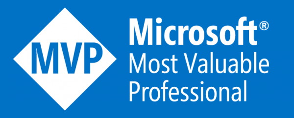

Jestem współzałożycielem [Protopii](https://protopia.tech), gdzie jako Managing Partner i Technology Advisor doradzam firmom w doborze technologii i budowaniu strategii IT.
Specjalizuję się w API Management i integracjach systemów oraz w bezpiecznym wdrażaniu AI w organizacjach regulowanych – od wspólnej bramy do API i agentów AI po polityki dostępu do modeli.
{: style="text-align: justify;"}

Jestem Microsoft [MVP](https://mvp.microsoft.com/en-us/PublicProfile/5003117) w kategorii Microsoft Azure i prowadzę warszawskie spotkania [Microsoft Azure User Group](https://www.facebook.com/groups/azureugpl/).
W podcaście „Powered by Protopia” rozmawiam z liderami IT o API Management, integracjach i agentach AI.
{: style="text-align: justify;"}

